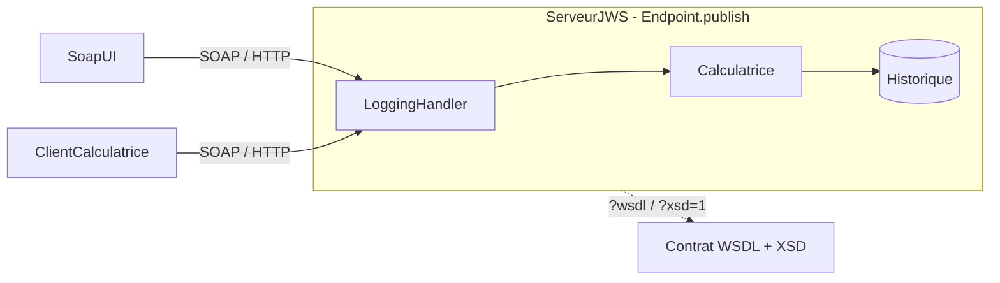
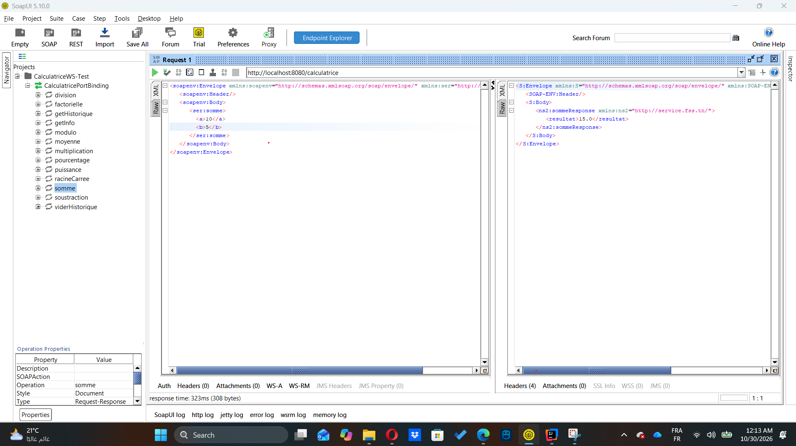
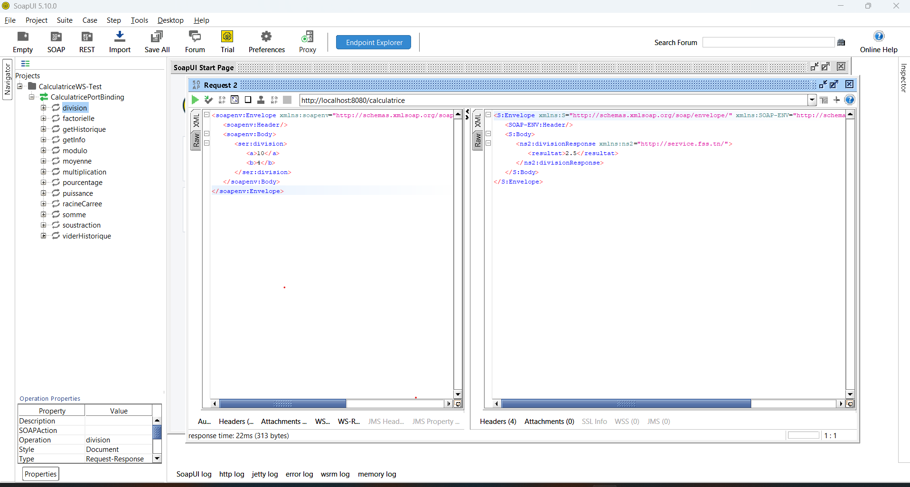
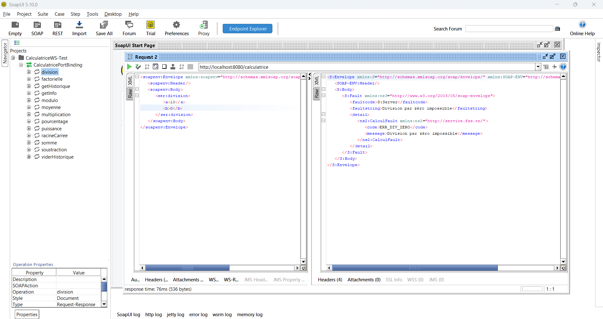

# CalculatriceWS — Service web SOAP avec Jakarta XML Web Services

TP2 · Architecture SOA et services web · LSI3-GLSI · Faculté des Sciences de Sfax · 2025-2026

Service web **SOAP** (Jakarta XML Web Services / JAX-WS) exposant une calculatrice : opérations de base,
opérations avancées, historique des calculs, gestion d'erreurs par **SOAP Fault typé**, journalisation
des messages par **SOAPHandler**, client Java et tests automatisés.

## Architecture



## Structure du projet

```
CalculatriceWS/
├── pom.xml
├── README.md
├── docs/
│   ├── ACTIVITES.md        correspondance énoncé ↔ projet
│   ├── WSDL_XSD.md         correspondance classe métier ↔ WSDL/XSD
│   ├── RAPPORT_WORD.md     plan du rapport + captures à faire
│   ├── SOAPUI.md           Activité 5 : test SoapUI pas à pas
│   ├── GIT.md              commits conseillés
│   ├── captures/           vos captures d'écran
│   └── exemples/           requêtes SOAP prêtes pour SoapUI / curl
└── src/
    ├── main/java/
    │   ├── service/        ICalculatrice, Calculatrice, Operation, CalculException, CalculFault, Constantes
    │   ├── serveur/        ServeurJWS, LoggingHandler
    │   └── client/         ClientCalculatrice
    └── test/java/service/  CalculatriceTest, CalculatriceIntegrationTest
```

## Opérations

| Opération | Paramètres | Retour | Erreur (SOAP Fault) |
|---|---|---|---|
| `somme` | a, b | double | – |
| `soustraction` | a, b | double | – |
| `multiplication` | a, b | double | – |
| `division` | a, b | double | `ERR_DIV_ZERO` si b = 0 |
| `puissance` | base, exposant | double | `ERR_RESULTAT_INVALIDE` |
| `racineCarree` | a | double | `ERR_RACINE_NEGATIVE` si a < 0 |
| `modulo` | a, b | double | `ERR_MODULO_ZERO` si b = 0 |
| `pourcentage` | valeur, taux | double | – |
| `moyenne` | valeurs (liste) | double | `ERR_LISTE_VIDE` |
| `factorielle` | n (0 à 20) | long | `ERR_FACTORIELLE` |
| `getHistorique` | – | liste d'`Operation` | – |
| `viderHistorique` | – | int | – |
| `getInfo` | – | String | – |

## Lancer le projet

**Prérequis** : JDK 17 ou plus, IntelliJ IDEA, SoapUI.

1. IntelliJ → *File → Open* → choisir le dossier `CalculatriceWS` (ou son `pom.xml`) → *Open as Project*.
2. Attendre l'import Maven (ou cliquer sur *Reload All Maven Projects*).
3. Exécuter `serveur.ServeurJWS` (clic droit → *Run*). Le programme reste actif : c'est le serveur.
4. Ouvrir le WSDL : <http://localhost:8080/calculatrice?wsdl>
   et le XSD : <http://localhost:8080/calculatrice?xsd=1>

En ligne de commande : `mvn compile exec:java`. Autre port : passer le port en argument de `ServeurJWS`.

## Tester

**SoapUI** (guide détaillé : [`docs/SOAPUI.md`](docs/SOAPUI.md)) : *File → New SOAP Project* → WSDL `http://localhost:8080/calculatrice?wsdl` →
ouvrir *Request 1* de l'opération → remplacer les `?` → ▶. Des requêtes toutes prêtes sont dans
`docs/exemples/`.

Exemple (`somme`) :

```xml
<soapenv:Envelope xmlns:soapenv="http://schemas.xmlsoap.org/soap/envelope/" xmlns:ser="http://service.fss.tn/">
   <soapenv:Body>
      <ser:somme><a>10</a><b>5</b></ser:somme>
   </soapenv:Body>
</soapenv:Envelope>
```

Réponse :

```xml
<ns2:sommeResponse xmlns:ns2="http://service.fss.tn/"><resultat>15.0</resultat></ns2:sommeResponse>
```

**curl** : `sh docs/exemples/tester.sh` (envoie toutes les requêtes d'exemple).

**Client Java** : lancer `client.ClientCalculatrice` (serveur démarré).

**Tests JUnit** : `mvn test` (arrêter le serveur avant n'est pas nécessaire : le test d'intégration utilise le port 8099).

## Captures d'écran (tests SoapUI)

### Opération somme (10 + 5 = 15.0)


### Opération division (10 / 4 = 2.5)


### Division par zéro : SOAP Fault typé (ERR_DIV_ZERO)

## Gestion d'erreurs

La division par zéro renvoie un **SOAP Fault typé** décrit dans le WSDL (`<wsdl:fault name="CalculFault">`) :

```xml
<faultstring>Division par zéro impossible</faultstring>
<detail><ns2:CalculFault><code>ERR_DIV_ZERO</code><message>Division par zéro impossible</message></ns2:CalculFault></detail>
```

## Choix techniques

- **Jakarta (`jakarta.*`) et non `javax.*`** : `jaxws-rt` 4.0.2 est cohérent avec `jakarta.xml.ws-api` et
  `jakarta.jws-api`, qu'il apporte transitivement. La 2.3.1 citée dans l'énoncé utilise l'ancien espace `javax.*`
  et ne se combine pas avec les API `jakarta.*`.
- **Contrat explicite** : `targetNamespace`, `operationName`, `@WebParam(name)`, `@WebResult(name)` donnent des
  noms lisibles dans le WSDL/XSD (sinon `arg0`, `arg1`, `return`).
- **Interface + implémentation** : `endpointInterface` relie la classe au contrat.

## Auteur

*Votre nom* — LSI3-GLSI — Faculté des Sciences de Sfax
